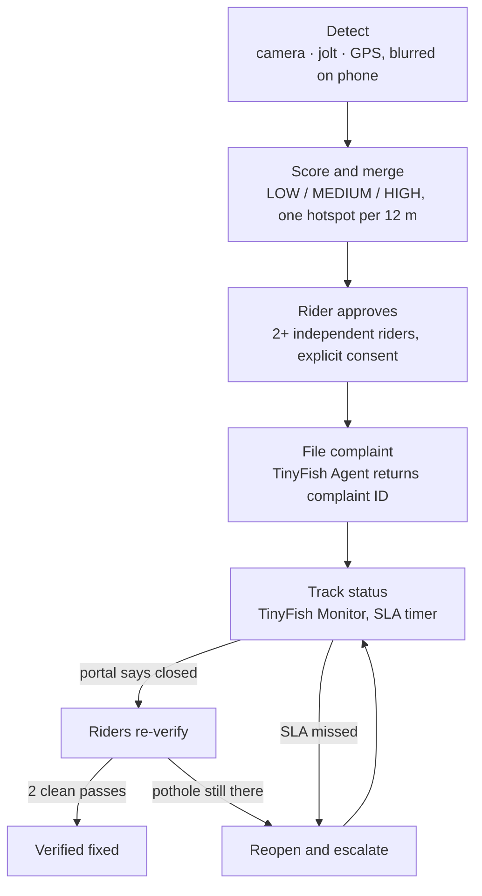

# RoadLoop

**Pothole reports that actually get fixed.**

RoadLoop detects potholes from riders' phones, uses TinyFish web agents to file complaints with the right authority, tracks them, and checks the city's work. If a portal says "closed" but riders still hit the pothole, RoadLoop reopens and escalates the complaint with fresh evidence. A pothole leaves the loop only when riders confirm the repair.

Team SpiritX (NIT Patna) · HackIIITD final, IIIT Delhi

---

## Contents

- [Why RoadLoop](#why-roadloop)
- [How it works](#how-it-works)
- [Architecture](#architecture)
- [Quick start](#quick-start)
- [Every-time startup (Windows)](#every-time-startup-windows)
- [Rider app on a phone](#rider-app-on-a-phone)
- [Running the demo](#running-the-demo)
- [Going live with TinyFish](#going-live-with-tinyfish)
- [Configuration](#configuration)
- [Project layout](#project-layout)
- [Design decisions](#design-decisions)
- [Testing](#testing)
- [Status and limitations](#status-and-limitations)
- [Troubleshooting](#troubleshooting)

---

## Why RoadLoop

India recorded **9,438 pothole-linked road deaths from 2020 to 2024**, rising from 1,555 a year to 2,385. People do report potholes. The loop breaks in three places:

1. **Reports disappear.** NHAI, state PWDs and municipal corporations each run their own portal, mostly with no API and no reliable status updates.
2. **No prioritisation.** A crater on a busy road counts the same as a dip on a quiet lane.
3. **"Closed" doesn't mean fixed.** Complaints are marked resolved without anyone checking the road.

Existing apps stop at "reported" and detection startups stop at "mapped". RoadLoop adds the accountability layer: it stops at **verified fixed**.

---

## How it works



1. **Detect.** In Drive mode the phone camera runs continuously. A pothole is captured by the on-device YOLO model when installed, or **hands-free by a hard jolt**: the app keeps the last 2.5 s of frames and sends the frame from just before the wheel hit. Riders never touch the phone while moving.
2. **Score.** Each report gets a severity class from visual size, speed-normalised jolt and road type.
3. **Merge.** Reports within 12 m become one hotspot. Confidence grows with each **distinct** rider.
4. **Approve.** A rider who reported the pothole approves filing under their own name.
5. **File.** A TinyFish agent fills the authority's portal and returns the complaint ID. OTP or CAPTCHA hands control to a human.
6. **Track.** A TinyFish Monitor watches the status page, with Fetch and polling fallbacks.
7. **Verify or escalate.** After "closed", riders passing the spot decide: two clean passes verify the fix, sightings reopen and escalate it.

The output is a **ranked engineer dashboard**: severity, crowd confidence, photo evidence, location, complaint ID, portal status, time open, SLA and a full audit timeline.

---

## Architecture

```
Phone app (PWA) ──HTTP──► FastAPI ──► PostgreSQL + PostGIS
                            │
                            └─jobs─► Redis ─► Celery worker ─► TinyFish (Agent · Search · Fetch · Monitor)
                                        ▲          │
                            Celery beat ┘          └─► Nominatim (reverse geocoding)
TinyFish ──webhooks──► FastAPI                React + MapLibre dashboard ◄── FastAPI
```

| Service | Port | Role |
|---|---|---|
| `db` | 5432 | PostgreSQL 16 + PostGIS 3.4 |
| `redis` | 6379 | Celery job queue |
| `api` | 8000 | FastAPI: REST API, webhooks, rider app at `/app/`, photos at `/media/` |
| `worker` | — | Celery: filing, tracking, geocoding |
| `beat` | — | Schedules status checks (30 min), SLA (60 min), priorities (15 min) |
| `mock` | 8100 | Offline stand-in for TinyFish plus a fictional grievance portal |
| `dashboard` | 5173 | React + Vite + MapLibre engineer queue |

A detailed walkthrough of the backend and database is in the team's slide deck.

---

## Quick start

Needs Docker Desktop, plus Python 3 and Node 18+ on the host for the demo script and JS tests. Works offline in mock mode, with no TinyFish key.

```powershell
copy .env.example .env                              # TINYFISH_MODE=mock
docker compose up -d --build
docker compose ps                                   # all 7 services should be running
docker compose run --rm api python -m pytest -q     # backend tests
pip install requests pillow
python scripts\demo.py --no-pause                   # scripted five-act demo
```

On macOS or Linux, use `cp` instead of `copy` and `/` instead of `\`.

| Open | URL |
|---|---|
| Engineer dashboard | http://localhost:5173 |
| API docs (Swagger) | http://localhost:8000/docs |
| Rider app (laptop) | http://localhost:8000/app/ |
| Fictional portal: new complaint | http://localhost:8100/portal/new |
| Fictional portal: officer desk (authority panel) | http://localhost:8100/portal/admin |
| Database browser (Adminer) | http://localhost:8080 (PostgreSQL · server `db` · user, password, db `roadloop`) |

The dashboard runs `npm install` on first start, so give it about a minute.

---

## Every-time startup (Windows)

The tunnel URL changes on every start, so these steps repeat each time.

1. **Open Docker Desktop** and wait for "Engine running".
2. **Start the tunnel** in its own PowerShell window and leave it open:
   ```powershell
   Stop-Process -Name cloudflared -ErrorAction SilentlyContinue
   cloudflared tunnel --protocol http2 --url http://localhost:8000
   ```
   Copy the printed `https://<words>.trycloudflare.com` URL.
3. **Update `.env`.** Change only this line, with no `/app/` and no trailing slash, and keep the comment below it on its own line:
   ```
   PUBLIC_BASE_URL=https://<words>.trycloudflare.com
   ```
4. **Start the stack** in the repo folder:
   ```powershell
   git pull
   docker compose up -d --build
   docker compose up -d --force-recreate api worker beat   # reload .env
   docker compose ps
   ```
5. **On the phone,** open `https://<words>.trycloudflare.com/app/`.

To stop: `docker compose down`, then close the cloudflared window. **Never** run `docker compose down -v`, which deletes the database.

---

## Rider app on a phone

The rider app is a progressive web app served by the API, so nothing is installed from a store. Phones only allow camera, GPS and motion sensors over **https**, which is why it goes through the tunnel above.

1. Open `https://<tunnel>/app/`, allow camera, location and motion, then **Add to Home Screen**.
2. Register with a name and a 10-digit mobile number. Portals require a number; it is used only for complaints the rider approves.

**Tabs**

- **Drive.** Mount the phone facing the road and tap Start. Potholes are captured hands-free by the model or by a jolt (above 10 km/h, at most one per 4 s). Nothing is uploaded unless a pothole is seen: then one blurred frame, GPS and jolt strength. With the model installed, it also re-checks "portal says fixed" spots automatically. **Mark pothole (passenger)** tags one by hand. Demo options: play a recorded dashcam video, or simulate GPS.
- **Report.** Take a photo, tap the pothole, pick a size, send. Everything except the tapped area is blurred on the phone, and re-encoding strips EXIF.
- **My reports.** Live status and complaint IDs. **Approve filing** is the consent step before an agent files.

Reports made offline wait on the phone and upload when the connection returns.

**Automatic detection needs a model.** Put `pothole.onnx` (a 320 px export from `detector/train.py`) and `model.json` in `backend/app/static/rider/model/`. Until then, Drive mode captures potholes by jolt and by the passenger button.

---

## Running the demo

### Scripted (recommended for judges)

```powershell
python scripts\demo.py
```
Press Enter between acts while narrating, with the dashboard open alongside. `--no-pause` runs straight through.

1. Six riders pass a crater → one HIGH hotspot.
2. A rider approves → the agent files on the fictional portal → complaint ID.
3. The officer closes the ticket without fixing anything.
4. The next rider still detects the crater → reopened and escalated with evidence.
5. The escalation is closed and two riders pass a clean road → **verified fixed**.

### Live, from phones

1. Report the same pothole from **two different riders** (two phones or two registrations). The hotspot is confirmed.
2. One of them taps **Approve filing** in My reports. A complaint ID appears on the dashboard.
3. In the officer desk, set that complaint to **Closed** (add a remark if you like) and click **Update**. RoadLoop re-reads the portal straight away: through the mock Monitor in mock mode, through a real TinyFish Fetch in live mode. The hotspot shows "Portal says closed: re-checking".
4. **To show a false closure:** two riders report the pothole again → reopened and escalated.
5. **To show a verified repair:** send two clean passes from two **different** riders in Swagger (`POST /v1/hotspots/{hotspot_id}/passes`):
   ```json
   { "rider_id": "<rider id>", "lat": 28.545, "lon": 77.273 }
   ```
   Create riders with `POST /v1/riders` (`{"display_name": "Verifier One", "phone": "9999900001", "consent": true}`), and find the hotspot ID and coordinates with `GET /v1/hotspots`. Passes must be within 25 m of the hotspot.

The fictional portal keeps complaints in memory, so restarting the `mock` container clears its list. Don't restart it mid-demo.

---

## Going live with TinyFish

The fictional portal's public pages are also served through the API at `/portal/...`, so **one tunnel** is enough: the real TinyFish cloud browser files on `https://<tunnel>/portal/new`, reads `https://<tunnel>/portal/status/<id>`, and calls the webhooks on the same URL. The officer desk is never exposed.

1. Get a key at agent.tinyfish.ai/api-keys. In `.env` set:
   ```
   TINYFISH_MODE=live
   TINYFISH_API_KEY=<your key>
   PUBLIC_BASE_URL=https://<tunnel>.trycloudflare.com
   WEBHOOK_TOKEN=<any long random string>
   ```
2. `docker compose up -d --force-recreate api worker beat mock`
3. Check it: open http://localhost:8000/health (`tinyfish_mode` should be `live`, `portal_base` your tunnel URL), then http://localhost:8000/v1/admin/tinyfish-check (one cheap TinyFish Search; `ok: true` means the key works). The dashboard header shows **TinyFish LIVE**.
4. Approve a filing from the phone. Watch `docker compose logs -f worker`: the agent run takes about one to three minutes, then the complaint ID appears on the dashboard and in the officer desk.

Status tracking in live mode: a TinyFish Monitor watches each status page on `MONITOR_CRON`. For the demo you don't wait for it: updating a ticket in the officer desk tells RoadLoop to re-read the page with TinyFish Fetch immediately (the dashboard's **Check portals now** does the same).

If the tunnel URL changes, monitors created on the old URL stop working; open complaints are still checked by Fetch every 30 minutes and by **Check portals now**.

For real government portals, walk each one with TinyFish first, fill its entry in `portals.json` (filing URL, status mode, OTP) and set `"verified": true`. Never send test complaints to a real government portal.

## Area memory: TinyFish researches a road once

Finding the responsible authority with TinyFish Search and Agent costs time and credits, so RoadLoop remembers the answer.

1. When a hotspot is confirmed, RoadLoop looks in **area memory** first: same road (highway ref or road name) in this ~1 km area or the neighbouring ones, or an area-wide rule an engineer set. A hit sets the authority instantly and the agent only files.
2. No hit: the free rule pass (NH → NHAI, SH → state PWD, city road → municipal corporation).
3. Only if the rules are unsure does TinyFish research it, and the result is stored for every later pothole on that road.
4. An engineer can correct the authority on the dashboard (for one road or the whole area). Engineer > TinyFish > rules: a weaker source never overwrites a stronger one.

Reverse geocoding is cached the same way (~150 m cells), so Nominatim is called once per stretch of road. The authority lookup also waits for geocoding instead of firing TinyFish on a hotspot with no road name. The dashboard shows how many TinyFish lookups area memory saved, and `GET /v1/areas` lists everything learned.

## Configuration

`.env` (copied from `.env.example`, never committed):

| Variable | Default | Meaning |
|---|---|---|
| `TINYFISH_MODE` | `mock` | `mock` uses the local mock service; `live` calls TinyFish |
| `TINYFISH_API_KEY` | empty | Needed for live mode |
| `PUBLIC_BASE_URL` | `http://localhost:8000` | Public https base for webhooks and photo links. No `/app/`, no trailing slash |
| `WEBHOOK_TOKEN` | — | Secret path segment protecting webhooks. Set a long random string |
| `SLA_DAYS` | `7` | Days before an open complaint is escalated |
| `MONITOR_CRON` | every 6 h, IST | Schedule for TinyFish Monitors |
| `GEOCODER` | `nominatim` | `off` disables reverse geocoding |

Tuning knobs, read by `backend/app/config.py`: `MIN_RIDERS=2`, `MIN_CONFIDENCE=0.85`, `MERGE_RADIUS_M=12`, `VERIFY_RADIUS_M=25`, `MAX_ESCALATIONS=3`. These are reasoned defaults, not field-tested values.

---

## Project layout

| Path | What |
|---|---|
| `backend/app/core/` | Pure logic: geohash merge, severity / confidence / priority, state machine, portal-status parser (English and Hindi), verification rule, authority routing |
| `backend/app/services/workflow.py` | The loop: ingest → merge → confirm → approve → file → track → verify → escalate |
| `backend/app/tinyfish/` | TinyFish client, agent goals and output schemas, portal registry (`portals.json`) |
| `backend/app/main.py` | REST API for the rider app and dashboard, plus webhooks |
| `backend/app/worker.py` | Celery tasks and beat schedule |
| `backend/app/models.py` | Tables: riders, detections, hotspots, complaints, pass_observations, agent_runs, audit_events |
| `backend/sql/001_postgis.sql` | PostGIS geography column, spatial index, priority index |
| `backend/app/static/rider/` | Rider PWA: drive mode, hands-free jolt capture, photo reports, approvals, offline queue |
| `dashboard/` | React + MapLibre engineer queue: ranked list, map, SLA clocks, complaint IDs, audit timeline |
| `detector/` | YOLO ONNX inference, IMU/GPS fusion, privacy redaction, dashcam CLI, training and export |
| `mock_tinyfish/` | Fictional municipal grievance portal (public pages + officer desk, persisted to a volume) and a TinyFish stand-in for mock mode |
| `scripts/demo.py` | The scripted judge demo |

---

## Design decisions

- **Severity classes, not millimetres.** Monocular depth is approximate, so severity fuses visible area, speed-normalised jolt and road type. A hotspot's score is the 70th percentile of its detections, so one bad frame can't escalate it.
- **Distinct riders, not passes.** Confidence is a noisy-OR over riders' best detections. Filing needs at least 2 riders and confidence 0.85. One phone passing ten times is one witness.
- **Consent enforced in code.** Only a rider who reported the pothole can approve filing, under their own name. Agents stop on OTP or CAPTCHA and return `needs_human`.
- **Hands-free capture.** A jolt above 10 km/h picks the buffered frame from just before impact, so riders never handle the phone while moving.
- **Physical evidence beats a "Closed" label.** Two clean passes verify a fix. Two sightings, or one detection with confidence ≥ 0.8 and jolt ≥ 0.5 g, reopen the ticket and escalate it citing the original complaint ID.
- **Strict state machine.** All allowed transitions live in one table; anything else raises an error. Every transition writes an audit event.
- **Idempotent everywhere.** Upload retries return the same row (`client_id`), agent runs are processed once (`handled`), and webhooks and polling are both safe to repeat.
- **Quota-aware TinyFish use.** One Monitor per open complaint, deleted on closure. If a Monitor can't be created, batched Fetch (10 URLs per call); login-only trackers get scheduled Agent lookups.
- **Privacy by default.** Blurred and EXIF-stripped on the phone, no continuous video uploaded, phone numbers used only for approved complaints.

---

## Testing

```powershell
docker compose run --rm api python -m pytest -q    # core logic, TinyFish client vs mock, DB/API flow
node --test backend/tests/js/logic.test.mjs         # rider app logic: YOLO decode, tracker, jolt capture
python scripts\demo.py --no-pause                    # end-to-end against the running stack
```

---

## Status and limitations

| Part | State |
|---|---|
| Full stack in Docker, scripted demo, dashboard (mock TinyFish) | Working on a team machine |
| Rider app on a real phone through a tunnel | Working: registration, reports, approval, filing, tracking |
| Hands-free jolt capture | Adaptive threshold, speed measured from GPS movement; JS tests pass (14). Not yet tuned on many real rides |
| Live TinyFish | Client matches the Agent API docs; portal reachable through the tunnel. Verify with `/v1/admin/tinyfish-check` and one filing |
| Area memory and geocode cache | Service-level tests added (`test_area_memory_*`, `test_geocode_cache`) |
| Pothole model weights | **Not included.** Without them Drive mode detects by jolt; train with `detector/train.py` |
| Real portal entries in `portals.json` | Unverified |
| iPhone Safari | Untested |

**Known limitations**

- No database migrations; new tables are created on start, but changing existing columns needs a reset.
- Jolt alone can't tell a pothole from a speed breaker; the photo, the two-rider rule and engineer review filter this until the model is trained.
- Without the model, a clean re-check comes from riding through the spot at speed with no bump. That is weaker evidence than the model seeing a clear road, so two different riders are required.
- Two potholes within 12 m merge into one hotspot.
- Admin endpoints are open unless `ADMIN_TOKEN` is set.

## Troubleshooting

| Symptom | Fix |
|---|---|
| Phone shows Cloudflare **Error 1033** | The tunnel is closed. Restart cloudflared and update `PUBLIC_BASE_URL` |
| Dashboard photos show "Blurred hazard frame" text | `PUBLIC_BASE_URL` is wrong or stale. Check it has no `/app/` and no comment on the same line, then `docker compose up -d --force-recreate api worker beat` |
| Phone says "The server was reset. Please register again" | Fresh database (new folder or volume). Register again |
| Camera or GPS doesn't work on the phone | Use the **https** tunnel link and check the browser's site permissions |
| A service isn't running | `docker compose logs <service> --tail 50` |
| VS Code shows red errors in `001_postgis.sql` | The SQL Server extension is checking Postgres syntax. Switch the file's language mode or disable that extension for this workspace |
| `git diff` ends with `:` | It's the pager. Press `q` |
